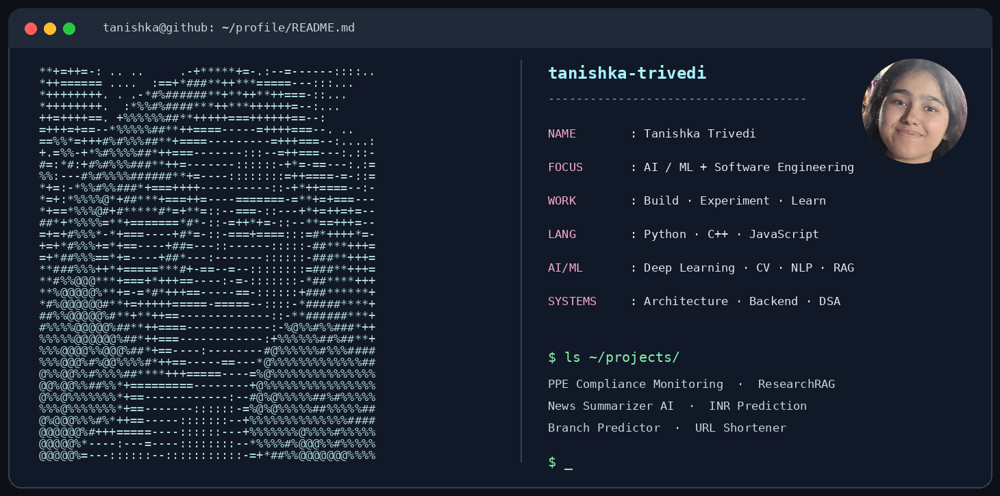

<!-- Profile README for github.com/tanishka-trivedi -->

### `tanishka@github:~$ whoami`

**AI / ML · Software Engineering · Computer Architecture**

*Exploring the intersection of intelligent models, reliable software, and real-world problems.*

## About Me

> Turning ideas into working systems through **machine learning, experimentation, and thoughtful engineering**.

I'm interested in building **end-to-end AI applications**—from understanding the underlying models and evaluating their performance to writing software that makes them useful. I also enjoy working closer to the systems layer, where **algorithms, performance, and architecture** come together.

- **AI & ML:** Computer vision, natural language processing, retrieval-augmented generation, deep learning, and time-series forecasting.
- **Software engineering:** Backend development, APIs, data structures, algorithms, and system design.
- **Computer architecture:** Branch prediction, hardware-aware performance, and experimental evaluation.
- **How I work:** Learn the fundamentals → implement → test → analyze → improve.

---

## Technical Focus Areas

| Focus | Areas I'm exploring |
| :-- | :-- |
| **Applied AI & ML** | Computer Vision · NLP · Deep Learning · Forecasting |
| **LLM & Retrieval Systems** | RAG · Document Retrieval · Knowledge-Grounded Applications |
| **Software Engineering** | Backend Services · APIs · Data Structures & Algorithms · System Design |
| **Computer Systems** | Computer Architecture · Operating Systems · Performance Evaluation |

---

## Tech Stack

<table>
<tr><th align="center">Programming</th><th align="center">AI / ML</th><th align="center">Data &amp; Backend</th><th align="center">Developer Tools</th></tr>
<tr>
<td align="center">
 
 
 

</td>
<td align="center">
 
 
 

</td>
<td align="center">
 
 
 

</td>
<td align="center">
 
 
 

</td>
</tr>
</table>

---

## Selected Projects

| Project | What it explores | Focus |
| :-- | :-- | :-- |
| **[PPE Compliance Monitoring System](https://github.com/tanishka-trivedi/PPE-Compliance-Monitoring-System)** | Computer vision applied to detecting personal protective equipment and monitoring safety compliance. | `Computer Vision` `Object Detection` |
| **[ResearchRAG](https://github.com/tanishka-trivedi/ResearchRAG)** | Retrieval-augmented approaches for working with research-oriented documents and information. | `LLMs` `RAG` `Retrieval` |
| **[News Summarizer AI](https://github.com/tanishka-trivedi/News-Summarizer-AI)** | Automatic summarization of news content using NLP techniques. | `NLP` `Text Summarization` |
| **[INR Price Prediction](https://github.com/tanishka-trivedi/INR-price-prediction)** | Exchange-rate forecasting and time-series modeling, including statistical approaches. | `Time Series` `Forecasting` |
| **[Multi-perspective Branch Predictor](https://github.com/tanishka-trivedi/Multi-perspective-Branch-Predictor)** | Exploring branch prediction techniques and evaluating microarchitectural performance. | `Computer Architecture` `C++` |
| **[URL Shortener](https://github.com/tanishka-trivedi/URL-Shortener)** | URL shortening and redirection through a backend-oriented application. | `Backend` `Web Development` |
| **[Attendance System CV](https://github.com/tanishka-trivedi/Attendance-System-CV)** | Applying computer vision to automate attendance-related workflows. | `Computer Vision` `Automation` |

Each project links to its repository for implementation details, code, and available documentation.

---

## GitHub Activity

  
  

Statistics are generated by an external service and may occasionally be unavailable.

---

## What I'm Exploring Next

- Building **AI/ML systems** that connect sound modeling choices with usable applications.
- Getting deeper into **retrieval, evaluation, and reliable AI workflows**.
- Improving at **software design, algorithms, and systems-level performance**.
- Collaborating on interesting **open-source, research, and engineering projects**.

---

## Let's Connect

I'm always up for a great discussion. You can connect here!

**Email:** [tanishkatrivedi.20@gmail.com](mailto:tanishkatrivedi.20@gmail.com)  
**GitHub:** [github.com/tanishka-trivedi](https://github.com/tanishka-trivedi)

---

<code>tanishka@github:~$ echo "Learn deeply. Build thoughtfully. Keep improving."</code>

